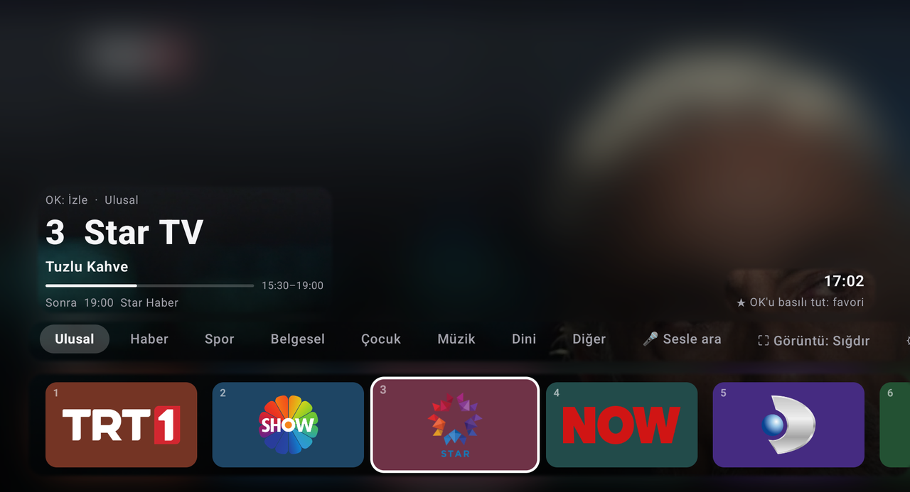
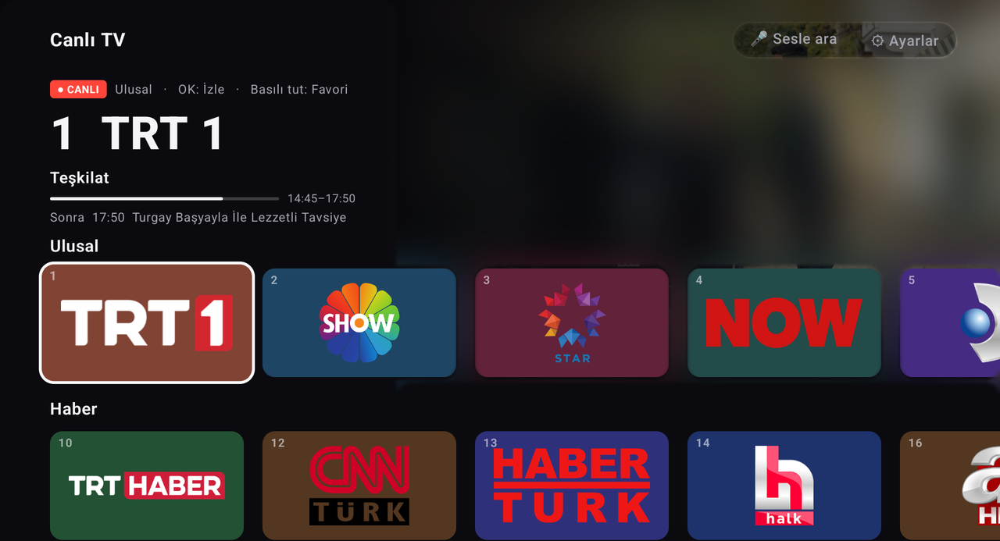
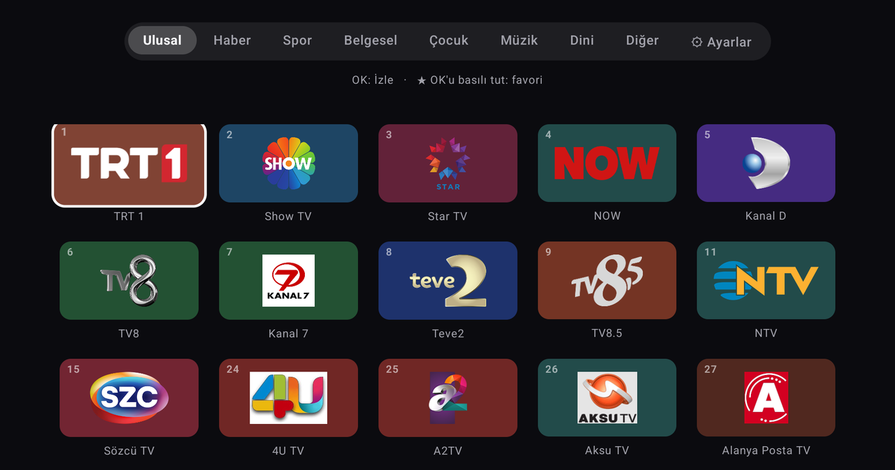
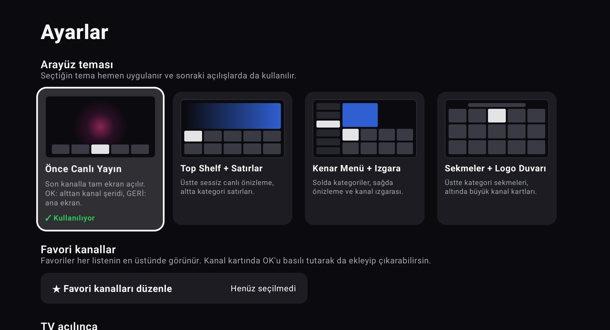
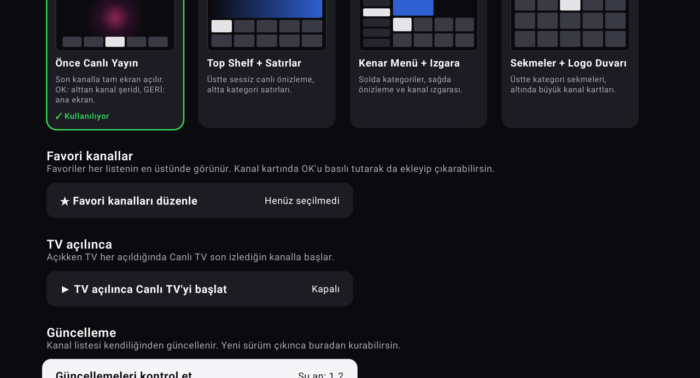

# Canlı TV

Android TV için kişisel canlı TV uygulaması. Yalnızca kanalların kendi sitelerinde ücretsiz yayınladığı yayınlar listelenir.

## Özellikler

- **135 ücretsiz kanal**, kategorilere ayrılmış: Ulusal, Haber, Spor, Belgesel, Çocuk, Müzik, Dini, Diğer
- **Sabit kanal numaraları**: kumandanın rakam tuşlarıyla doğrudan kanala geç (1 TRT 1, 2 Show TV, 3 Star TV…), ◀ ile son izlenen kanala dön
- **Hızlı kanal değiştirme**: bir yayın açılmazsa kanalın diğer kaynakları otomatik denenir
- **Şimdi / Sonra yayın akışı**: o an yayındaki program, ilerleme çubuğu ve sıradaki program
- **Favoriler**: kanal kartında OK'u basılı tutarak ekle; favoriler her listenin en üstünde görünür
- **TV ana ekranında favoriler satırı**: favori kanalları TV'nin ana ekranından tek tuşla aç
- **Sesli arama** 🎤: kanal adını ya da numarasını söyle („TRT bir", „Show TV'yi aç", „on iki")
- **Görüntü oranı**: Sığdır / Doldur / Uzat; her kanal için ayrı hatırlanır
- **TV açılınca otomatik başlatma** (isteğe bağlı): TV açıldığında son izlenen kanal açılır
- **Kendiliğinden güncelleme**: kanal listesi arka planda güncellenir, yeni sürümler Ayarlar'dan tek tuşla kurulur
- **4 arayüz teması**: Önce Canlı Yayın, Top Shelf + Satırlar, Kenar Menü + Izgara, Sekmeler + Logo Duvarı

## Ekran görüntüleri

| | |
|---|---|
|  |  |
| Top Shelf teması: üstte canlı önizleme ve yayın akışı | Sekmeler + Logo Duvarı teması |
|  |  |
| Arayüz teması seçimi | Favoriler, otomatik başlatma, güncelleme |

*Ekran görüntülerinde yayın görüntüleri bulanıklaştırılmıştır.*

## Kumanda

| Tuş | İzlerken | Kanal şeridi açıkken |
|---|---|---|
| OK | Kanal şeridini aç | Seçili kanalı izle |
| OK (basılı tut) | | Favoriye ekle / çıkar |
| ▲ ▼ (veya CH +/−) | Kanal değiştir | |
| ◀ (veya LAST) | Son izlenen kanala dön | |
| 0–9 | Kanal numarasıyla geç | |
| GERİ | Ana ekrana dön | Şeridi kapat |
| 🎤 / Ara | Sesli arama | Sesli arama |

## Kurulum

1. TV'de *Downloader* uygulamasını aç ve şu adresi yaz:
   `https://github.com/sehaerkut/canli-tv/releases/download/stable/canli-tv.apk`
2. İstenirse Downloader'a „bilinmeyen uygulamaları yükleme" izni ver.
3. Google Play Protect tarama isterse „Taramadan yükle"yi seç.

Gereksinim: Android TV / Google TV, Android 7.0 veya üstü.

Kurulumdan sonra kanal listesi kendiliğinden güncellenir. Yeni sürümler **Ayarlar › Güncelleme** bölümünden kurulur.
